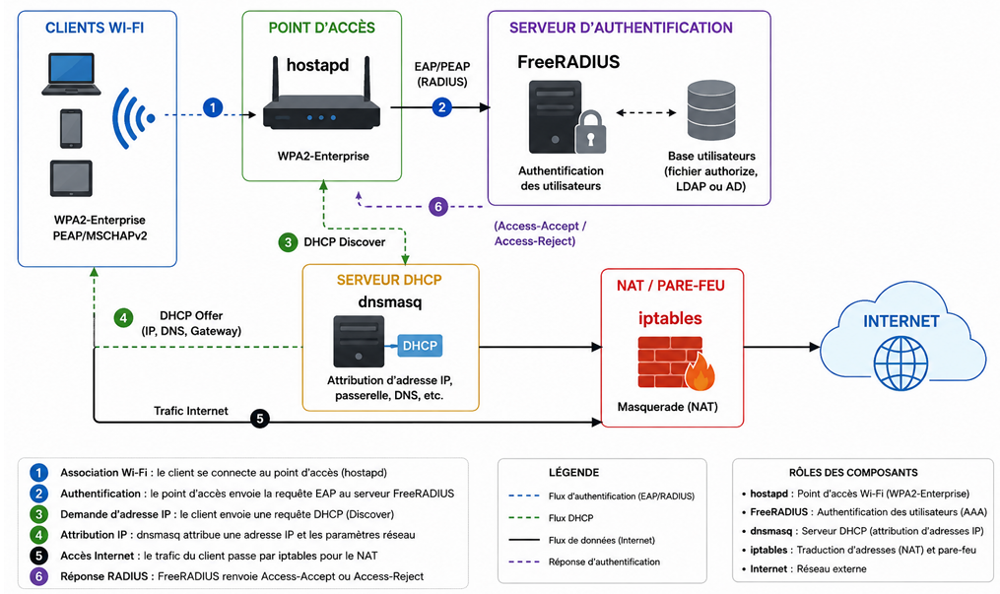

# Mise en Place d'un Wi-Fi D’Entreprise PEAP



Voici comment configurer FreeRADIUS pour créer un réseau Wi-Fi WPA2-Enterprise.
L'architecture typique place FreeRADIUS (serveur d'authentification) derrière votre point
d'accès (authenticator)

### 1. Installation de FreeRADIUS

- Sur Debian/Ubuntu/Kali :

```jsx
sudo apt update
sudo apt install freeradius freeradius-common freeradius-utils
```

- Sur OpenWRT :

```jsx
opkg update
opkg install freeradius3 freeradius3-common freeradius3-mod-eap freeradius3
mod-eap-tls
```

### 2. Configuration des clients (points d'accès)

- Éditez le fichier /etc/freeradius/3.0/clients.conf ou ( /etc/raddb/clients.conf ) pour déclarer votre point d’accès :

```jsx
client mon_ap {
ipaddr = 192.168.1.100          # IP de votre point d'acces
secret = testing123             # Secret partagé
shortname = mon_ap
nastype = other
}
```

### 3. Configuration EAP (PEAP/MSCHAPv2)

C'est la méthode la plus courante : elle nécessite un certificat serveur, mais pas de certificats
clients

#### 3.1 Générer les certificats

- FreeRADIUS fournit un script pour générer des certificats de test :

```jsx
cd /etc/freeradius/3.0/certs
make
```

- Pour une utilisation en production, vous pouvez utiliser Let's Encrypt ou votre propre autorité de
certification

#### 3.2 Configurer le module EAP

- Éditez /etc/freeradius/3.0/mods-enabled/eap :

```jsx
		eap {
				default_eap_type = peap
				timer_expire = 60
				tls-config tls-common {
						private_key_password = whatever
						private_key_file = ${certdir}/server.key
						certificate_file = ${certdir}/server.pem
						ca_file = ${cadir}/ca.pem
						dh_file = ${certdir}/dh
						random_file = /dev/urandom
						fragment_size = 1024
						cipher_list = "DEFAULT"
						tls_min_version = "1.2"
						tls_max_version = "1.2"
				}
				peap {
						tls = tls-common
						default_eap_type = mschapv2
						copy_request_to_tunnel = no
						use_tunneled_reply = yes
						virtual_server = "inner-tunnel"
				}
						mschapv2 {
				}
		}
```

### 4. Configuration des utilisateurs

- Ajoutez des comptes utilisateur dans :  /etc/freeradius/3.0/mods-config/files/authorize :

```jsx
alice    Cleartext-Password := "motdepasse123"
bob      Cleartext-Password := "bob2024"
```

### 5. Démarrer et tester FreeRADIUS

- Test en mode debug (Je recommande)

```jsx
sudo freeradius -X
```

- Si tout fonctionne, à la fin, vous verrez :

```jsx
Listening on auth address * port 1812
Ready to process requests
```

- Test avec radtest (client RADIUS)

```jsx
radtest alice motdepasse123 localhost 0 testing123
```

- Réponse attendue : Access-Accept

Démarrer le service

```jsx
sudo systemctl enable freeradius
sudo systemctl start freeradius
```

### 6. Configuration du point d'accès (hostapd)

Le fichier  /etc/hostapd/hostapd.conf doit contenir :

```jsx
interface=wlan0
driver=nl80211
ssid=MonReseauEntreprise
hw_mode=g
channel=6
ieee80211d=1
country_code=FR
# WPA2-Enterprise
wpa=2
wpa_key_mgmt=WPA-EAP
wpa_pairwise=CCMP
rsn_pairwise=CCMP
# Configuration RADIUS
ieee8021x=1
auth_server_addr=127.0.0.1
    # 
IP du serveur FreeRADIUS
auth_server_port=1812
auth_server_shared_secret=testing123
radius_client_addr=127.0.0.1
```

- Démarrez hostapd :

```jsx
sudo systemctl restart hostapd
```

### 7. Configuration des clients Wi-Fi

- Android

| Paramètre | Valeur |
| --- | --- |
| Sécurité | WPA2-Enterprise |
| Méthode EAP | PEAP |
| Authentification phase 2  | MSCHAPv2 |
| Identité |  alice |
| Mot de passe  | motdepasse123 |
| Domaine  | (laissez vide si certificat auto-signé) |
| Certificat CA  | Ne pas vérifier (pour test) |

**Windows**

- Sécurité : WPA2-Enterprise
- Méthode d'authentification : PEAP (Protected EAP)
- Mode d'authentification : Authentification par mot de passe sécurisé (EAP-MSCHAP v2)
- Cochez "Valider l'identité du serveur" si vous utilisez un certificat valide

**Dépannage**

| Problème  |  Vérification |
| --- | --- |
| FreeRADIUS refuse les connexions  | Lancez freeradius -X pour voir les logs détaillés |
| hostapd ne démarre pas  | Vérifiez que wpa=2 et non wpa=1 |
| Connexion impossible  | Vérifiez le secret partagé (clients.conf vs hostapd.conf) |
| Erreur de certificat   | Utilisez "Ne pas vérifier" côté client pour les tests |

#### Résumé des fichiers de configuration

| Fichier  | Rôle |
| --- | --- |
| /etc/freeradius/3.0/clients.conf  | Déclare le point d'accès (IP +secret) |
| /etc/freeradius/3.0/mods-enabled/eap  | Configuration PEAP/TLS |
| /etc/freeradius/3.0/mods -config/files/authorize | Liste des utilisateurs/mots de
passe |
| /etc/hostapd/hostapd.conf | Configuration du point d'accès WiFi |